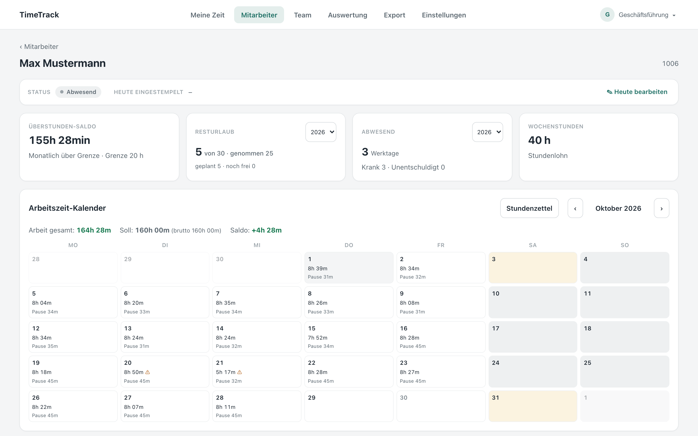
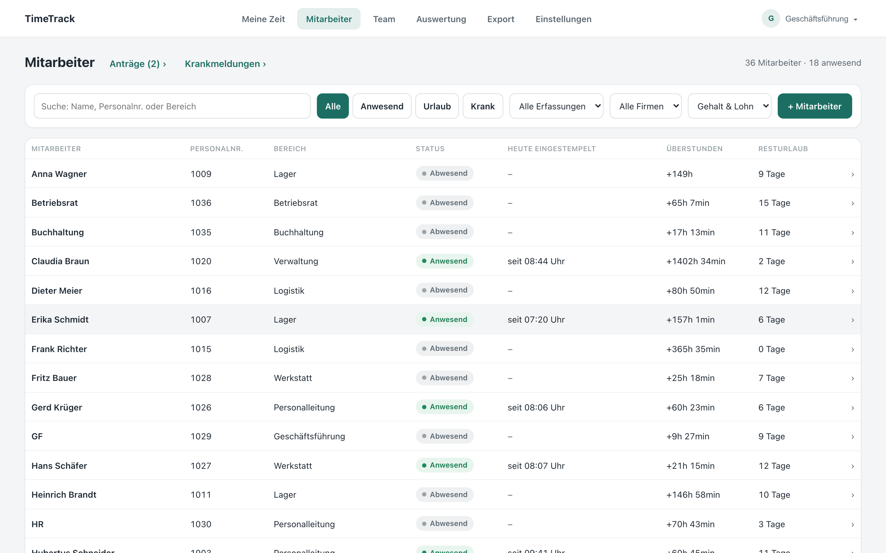
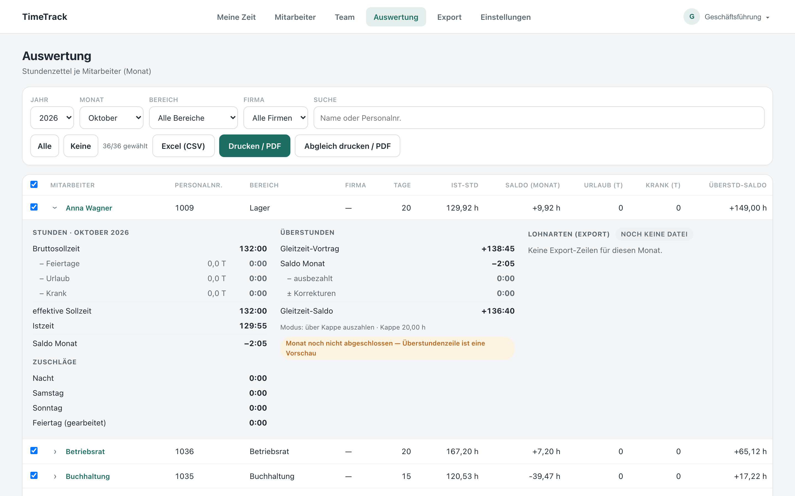
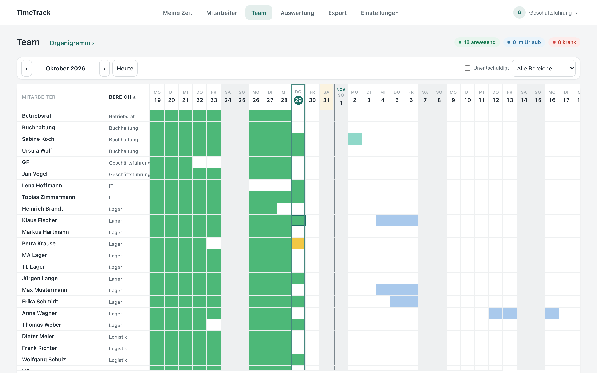
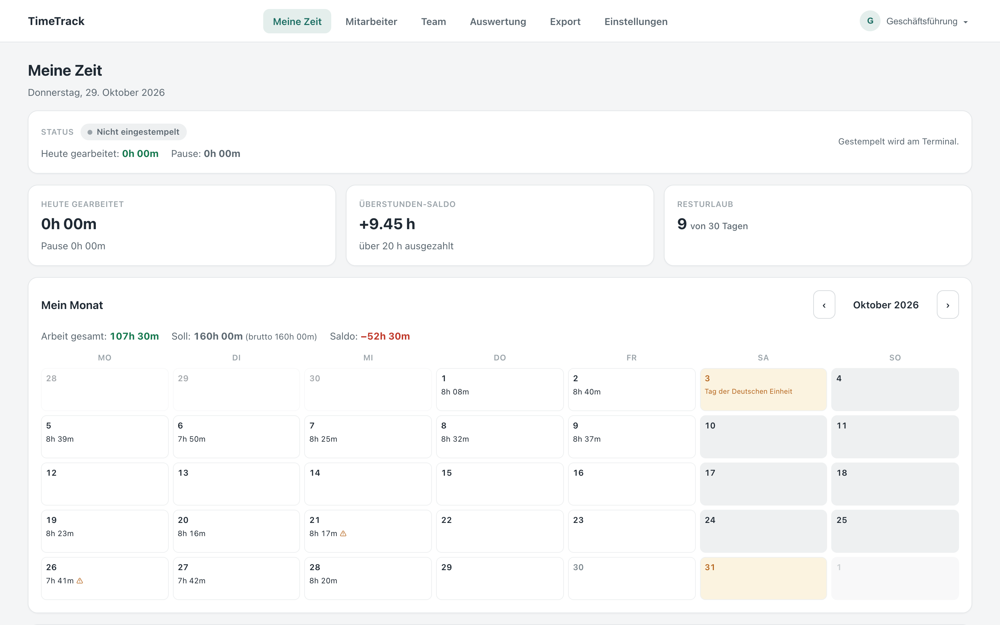

<div align="center">

# TimeTrack

**Time tracking, absence management and payroll export for German SMEs —
from the NFC tap at the wall terminal to the DATEV file for the payroll office.**

[](https://github.com/Coco247365/timetrack/actions/workflows/ci.yml)
[](LICENSE)




</div>

---

## Why TimeTrack

Most time-tracking tools stop at "hours worked". Payroll in Germany needs more: statutory
break rules, overtime accounts with payout caps, vacation and sick-leave accounting, and a
file the payroll office can import. TimeTrack covers the whole chain in one system — and every
number in a timesheet, an overtime account or a payroll file is derived from **the same
immutable punch log**, so they can never disagree.

```
  NFC terminal  ──►  punch events  ──►  daily timesheets  ──►  overtime ledger  ──►  DATEV LODAS
  (Rust/Pi)          (append-only)      (computed, rules)      (monthly close)       (payroll file)
```

## Highlights

| | |
|---|---|
| 🪪 **Tamper-resistant terminal** | Raspberry Pi kiosk in Rust/Slint. MIFARE DESFire EV2 fobs are verified by challenge-response through a SAM chip, so cloned cards are rejected. Offline queue with idempotent replay. |
| 🧾 **Append-only by design** | Punches are never edited. Corrections add events with author and reason; the full raw log stays auditable. |
| ⚖️ **Labour-law aware** | Statutory breaks (ArbZG §4) and configurable company break rules, earliest-start and punch windows per work-time profile, night shifts across midnight, public holidays per federal state. |
| ⏱️ **Real overtime accounting** | Monthly settlement into an overtime ledger with payout modes (none / all / above a cap), carry-over and corrections. |
| 📑 **Payroll export** | DATEV LODAS files with preview, per-company wage-type profiles, export history with checksums, and a per-employee reconciliation sheet that shows exactly how each wage type was computed. |
| 🏢 **Multi-tenant** | Tenants, companies and departments, roles with fine-grained permissions, four-eyes approval for leave, separately protected sick-leave details, full audit log. |

## Screenshots

<table>
  <tr>
    <td width="50%"><br><sub><b>Employee overview</b> — live attendance, overtime and remaining vacation</sub></td>
    <td width="50%"><br><sub><b>Monthly reconciliation</b> — target-hours chain, overtime and wage types per employee</sub></td>
  </tr>
  <tr>
    <td width="50%"><br><sub><b>Team calendar</b> — attendance, vacation and sick leave across the month</sub></td>
    <td width="50%"><br><sub><b>Self-service</b> — employees see their own time, balance and leave</sub></td>
  </tr>
</table>

<sub>All screenshots show the bundled demo data set with fictional employees.</sub>

## Features

<details open>
<summary><b>Capture</b></summary>

- Punch in/out and breaks at the NFC terminal; automatic daily hours for salaried staff
- Offline queue on the terminal, replayed idempotently once the connection is back
- Personal messages after punching, broadcast messages on the idle screen
- Card management: assign, revoke and replace fobs without touching recorded time
</details>

<details>
<summary><b>Review</b></summary>

- Daily timesheets computed from the punch log: gross/net time, breaks, night, Sunday and holiday work
- Break rules are applied *and shown* — the timesheet explains why a break was added
- Manual corrections with audit trail; immutable punch protocol per employee
- Vacation and sick-leave requests with approval workflow, half days and overlap checks
- Team calendar, org chart, monthly and yearly reports, printable timesheets, Excel export
</details>

<details>
<summary><b>Payroll</b></summary>

- Overtime ledger with monthly close and payout modes, including a tiered surcharge model
- Wage-type catalogue and per-company wage-type profiles
- Surcharge windows for night, Saturday and Sunday work, configurable per tenant
- DATEV LODAS export with preview, history and checksums; working students exported with actual hours
- Monthly overview as Excel, `.ics` absence feed for Outlook/Teams
</details>

<details>
<summary><b>Administration & security</b></summary>

- Roles and individually switchable permissions (from employee to management)
- JWT auth with refresh-token rotation, Argon2id password hashing, login lockout, rate limiting
- Tenant-scoping guard enforced by a static-analysis test, so no query can leak across tenants
- Sick-note mailbox via Microsoft Graph, feature switches per tenant
</details>

## Architecture

| Component | Tech | Role |
|---|---|---|
| **Backend** | FastAPI, SQLAlchemy 2 async (asyncpg), PostgreSQL 16, Redis, Alembic | REST API and business logic |
| **Frontend** | Nuxt 4 SPA, Vue 3, TypeScript | Admin and self-service portal (pure API client) |
| **Kiosk** | Rust, Slint, PC/SC (ACR1252U with SAM slot) | NFC wall terminal on a Raspberry Pi 5 |

```
backend/     FastAPI app (src/zeiterfassung/), Alembic migrations, tests
  ├─ api/v1/      route handlers
  ├─ services/    orchestration: load → apply rules → persist
  ├─ policy/      pure rule functions (no DB, no HTTP) — breaks, absences, overtime, permissions
  ├─ payroll/     payroll rules (clipping, surcharges)
  └─ core/        ArbZG engine, DATEV writer, holidays, security
frontend/    Nuxt 4 SPA (app/pages, app/components)
kiosk/       Rust + Slint terminal (kiosk/kiosk = crate), SAM ceremony tooling, Pi config
docs/        data model & API reference, terminal hardware guides
```

The portal uses JWT bearer auth; terminals authenticate with a per-device key. Business rules
live in `policy/` as pure functions, which keeps them easy to test — the backend ships with
**over 1,000 tests**.

## Getting started

### Docker

```bash
git clone https://github.com/Coco247365/timetrack.git && cd timetrack
cp .env.example .env      # set POSTGRES_PASSWORD, ZEITERFASSUNG_JWT_SECRET, SITE_ADDRESS
docker compose up -d --build
```

Caddy terminates TLS (Let's Encrypt for a real domain, internal CA for `localhost`), a one-shot
`migrate` service applies the database schema, and `db-backup` writes nightly dumps to `./backups`.

### Local development

Requirements: PostgreSQL 16, Python 3.12+ with [uv](https://docs.astral.sh/uv/), Node 20+ with pnpm.

```bash
bash scripts/dev-bootstrap.sh                    # database, backend/.env, dependencies, demo data
cd backend && bash scripts/run.sh                # API  → http://127.0.0.1:8000/docs
cd frontend && NUXT_PUBLIC_API_BASE=/ pnpm dev   # UI   → http://localhost:3000
```

The demo data set contains a fictional company (*Muster GmbH*) with three years of history up
to yesterday. Log in as `gf@example.com` with the password printed by the bootstrap script.
For a reproducible data set, seed with `DEMO_TODAY=2026-03-24`.

### Terminal

```bash
cd kiosk/kiosk && cargo run                       # desktop, simulated card reader
cargo build --release --features real-reader      # on the Pi with an ACR1252U
```

Hardware, wiring, provisioning and troubleshooting are documented in
[`docs/terminal/`](docs/terminal/INDEX.md); the DESFire/SAM setup in
[`kiosk/SAM-VOR-ORT-ANLEITUNG.md`](kiosk/SAM-VOR-ORT-ANLEITUNG.md). `kiosk/pi/` contains an
example start script — device key, tenant id and backend URL are placeholders.

## Testing

```bash
cd backend  && uv sync --extra dev && uv run ruff check . && uv run pytest
cd frontend && pnpm lint && pnpm test
cd kiosk/kiosk && cargo test
```

## Glossary

The domain is German labour and payroll law, so the UI and many identifiers are German.

| German | English | | German | English |
|---|---|---|---|---|
| Stempeln | punching | | Lohnart | wage type |
| Tagesbogen | daily timesheet | | Lohnprofil | wage-type profile |
| Soll / Ist | target / actual hours | | Monatsabschluss | monthly close |
| Gleitzeit | flexitime | | Abwesenheit | absence |
| Überstunden | overtime | | Bereich / Firma | department / company |
| Urlaub / Krank | vacation / sick leave | | Mandant | tenant |

A detailed German reference of tables, enums and endpoints is in
[`docs/datenmodell-und-api.md`](docs/datenmodell-und-api.md).

## License

[MIT](LICENSE)
